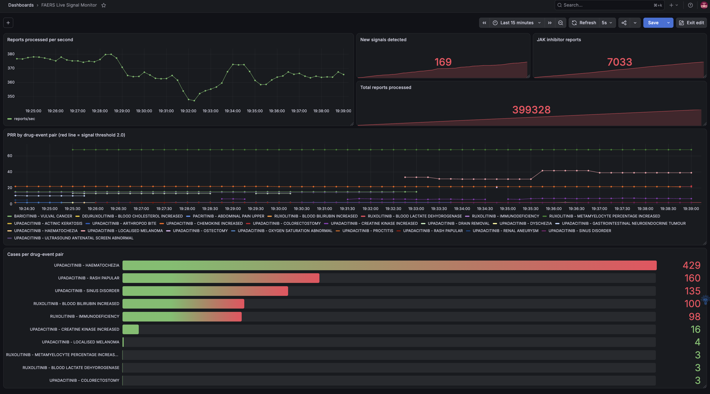

# Real-time safety signal monitoring (streaming extension)

Extends the FAERS signal-detection project with a streaming pipeline that recalculates
disproportionality for JAK inhibitors as new adverse-event reports arrive, with live
monitoring and dashboards.



## Architecture

FAERS reports (DuckDB) -> producer.py -> Kafka topic `faers-reports` -> consumer.py
-> new signals to Kafka topic `faers-signals`; consumer metrics -> Prometheus -> Grafana

## How it works

- **Baseline:** the consumer loads all reports before the most recent quarter from
  `faers.duckdb` and builds drug, event and drug-event counts.
- **Simulated live feed:** the producer replays the most recent quarter in FDA-received
  date order, one report per Kafka message.
- **Detection:** for every JAK inhibitor x reaction pair in each incoming report, the
  consumer updates the 2x2 table and recomputes PRR and Yates chi-square. A pair is flagged
  as a new signal when it meets the Evans criteria (PRR >= 2, chi-square >= 4, cases >= 3)
  for the first time.
- **Noise reduction:** non-clinical MedDRA terms (product issues, dosing and medication
  errors, off-label use, drug ineffective) are excluded.
- **Monitoring:** Prometheus scrapes throughput, report counts, signals flagged, and PRR and
  case counts for the top 10 emerging signals. Grafana shows them live.

## Run it

```bash
cd streaming
docker compose up -d            # Kafka, Prometheus, Grafana
python consumer.py              # wait for "Ready"
python producer.py 500          # second terminal; argument = reports/sec
```

Grafana: http://localhost:3000 (admin/admin). Import `grafana-dashboard.json`.
Prometheus: http://localhost:9090.

## Limitations

- This is a simulated real-time replay of historical FAERS data, not a production feed.
- Disproportionality signals are hypotheses for review, not evidence of causation.
- Confounding by indication remains (e.g. GI events for upadacitinib, which is used in IBD).
- Counts are held in memory; a restart rebuilds the baseline.
